# BreedingR <a href="https://phyllype.github.io/BreedingR/"></a>

<!-- badges: start -->
[](https://github.com/phyllype/BreedingR/actions/workflows/R-CMD-check.yaml)
[](https://phyllype.github.io/BreedingR/)
[](https://lifecycle.r-lib.org/articles/stages.html#experimental)
[](https://github.com/phyllype/BreedingR/blob/main/DESCRIPTION)
[](https://github.com/phyllype/BreedingR/blob/main/LICENSE.md)
[](https://github.com/phyllype/BreedingR/commits/main)
<!-- badges: end -->

Genetic parameters, breeding values and genomic prediction in R. One engine fits the
animal model and its close relatives: direct-maternal, sire and maternal-grandsire,
reaction norms, several traits and the single step. It fits them by AI-REML, or samples
them with a Gibbs sampler for Gaussian and binary traits. The numerics are written in
the package itself, in `src/`, and `R CMD INSTALL` compiles them. No separate binary, no
service, no run-time dependency.

<table>
<tr>
<th align="left">Models</th>
<th align="left">Genomics</th>
<th align="left">Estimation and tools</th>
</tr>
<tr>
<td valign="top">

- animal model, repeatability: `model()`
- direct-maternal; sire and maternal grandsire
- reaction norms on a gradient: `rn()`
- several traits: `model_mt()`

</td>
<td valign="top">

- single step: exact or APY inverse of G
- ssSNPBLUP, which never forms G: `snp_blup()`
- metafounders, Gamma estimated from the genotypes
- marker effects from a single-step fit
- `pegs()` for many environments of one trait
- genotype QC and parentage; PLINK and BLUPF90 files

</td>
<td valign="top">

- AI-REML with a convergence certificate
- block Gibbs sampler, probit for binary traits: `gibbs()`
- breeding values, accuracy, h2, genetic correlations
- selection index, ranking drift
- residuals and MCMC diagnostics
- gene-dropping simulator

</td>
</tr>
</table>

## Installation

```r
# straight from GitHub with base R only; it compiles, so Windows needs Rtools and macOS
# the Xcode command-line tools. Downloading first keeps RStudio from trying to read the
# URL as a local file (harmless "tar.exe: Error opening archive" warnings otherwise).
f <- file.path(tempdir(), "BreedingR.tar.gz")
download.file("https://github.com/phyllype/BreedingR/archive/refs/heads/main.tar.gz", f,
              mode = "wb")
install.packages(f, repos = NULL, type = "source")
# or with remotes, installed first with install.packages("remotes")
remotes::install_github("phyllype/BreedingR")
# or from a local clone, giving the folder that holds DESCRIPTION
install.packages("C:/path/to/BreedingR", repos = NULL, type = "source")

library(BreedingR)
packageVersion("BreedingR")   # the examples here need 0.4.0.9000
```

The CI installs the package both ways from GitHub on every push and runs the quick start
with the installed copy. To update on Windows, first close every R session that loaded
BreedingR, RStudio included. Windows locks the DLL of a loaded package, and the install
stops with "cannot remove earlier installation".

## Quick start

A complete run on data the package simulates itself, paste and go:

```r
library(BreedingR)
s <- simulate_breeding(n_founders = 60, n_generations = 3,
                       offspring_per_generation = 600, h2 = 0.4,
                       seed = 1)                        # pedigree + phenotypes, 1,860 animals

q  <- qc_phenotypes(s$data, "y", classes = "cg")        # flag, count, never drop silently

fit <- model(y ~ cg + animal(id), q$data, s$pedigree)
fit                                # components, SEs, share of the phenotypic variance
h2(fit)                            # the var(animal) share; 4 var(sire) / Vp in a sire model
head(solutions(fit, s$pedigree))   # id, ebv, se, acc, sorted by breeding value
accuracy(fit, s$pedigree)[1:5]     # prior 1+F, or the G* diagonal if genotyped
cor(ebv(fit)[names(s$tbv)], s$tbv) # against the simulator's own truth
```

<picture>
  <source media="(prefers-color-scheme: dark)" srcset="man/figures/README-ebv-dark.svg">
  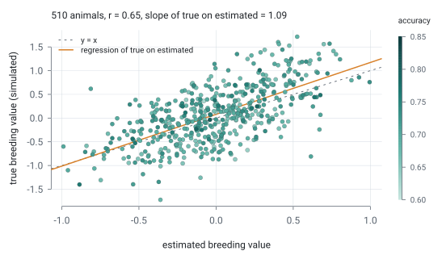
</picture>

*The fit above against the simulator's truth: each point is an animal, colored by the
accuracy the fit reports. The figures on this page are drawn by `tools/figuras_readme.R`
from simulated data.*

## What it fits

One engine, and the formula terms choose the model. Each group below says what kind of
data it is for, names the fitter, shows a minimal call and one result on simulated data.
[The map of models and terms](https://phyllype.github.io/BreedingR/articles/models.html#the-map)
lists every term with its options.

### Animal model, repeatability and direct-maternal

One record or repeated records per animal, with a pedigree. A maternal effect enters as a
second term of the same covariance group, so the direct-maternal correlation is estimated.

```r
model(weight ~ cg + animal(id) + pe(id), data, ped)
model(weight ~ cg + animal(id, group = "g") + maternal(dam, group = "g") + pe(dam), data, ped)
```

<picture>
  <source media="(prefers-color-scheme: dark)" srcset="man/figures/README-animal-dark.svg">
  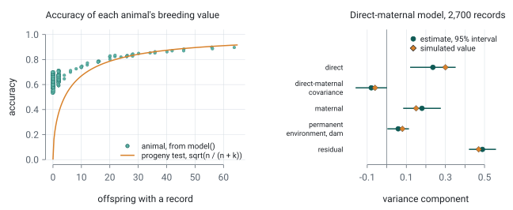
</picture>

*Left: the accuracy of each animal's breeding value against its offspring with a record.
Right: a direct-maternal fit, each component with its 95% interval beside the value
simulated.* [More details](https://phyllype.github.io/BreedingR/articles/models.html#animal-model-repeatability-direct-maternal-and-sire-models)

### Random regression and reaction norms

Records along a continuous axis: an environmental gradient for a reaction norm, or time.
The regression is a formula term on a Legendre basis.

- `model()` with `rn(id, base = )`: a random regression of each animal on the basis
- `h2_curve()` and `plot()`: the heritability along the axis

```r
d <- cbind(d, legendre(d$thi, order = 1, limits = c(60, 84)))
fit <- model(y ~ cg + rn(id, base = c("phi0", "phi1")) + pe(id), d, ped)
h2_curve(fit, limits = c(60, 84))
```

<picture>
  <source media="(prefers-color-scheme: dark)" srcset="man/figures/README-rn-dark.svg">
  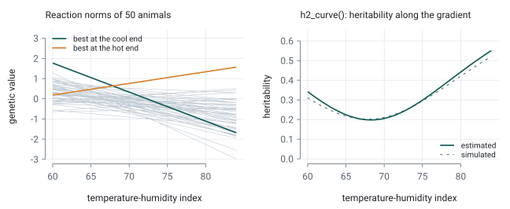
</picture>

*Left: the genetic reaction norms of 50 animals; the best animal at the cool end is not
the best at the hot end. Right: `h2_curve()` against the simulated heritability.*
[More details](https://phyllype.github.io/BreedingR/articles/models.html#random-regression-and-reaction-norms)

### Several traits

Traits recorded on the same animals, with a full residual covariance and a missing trait
handled record by record: `model_mt()`, and `rg()` for each genetic correlation. For many
environments of one trait, `pegs()` fits a model of the markers, with uncorrelated
residuals between environments.

```r
fit <- model_mt(cbind(y1, y2, y3, y4) ~ cg + animal(id), d, ped)
rg(fit, "animal", "y1", "y2")
```

<picture>
  <source media="(prefers-color-scheme: dark)" srcset="man/figures/README-mt-dark.svg">
  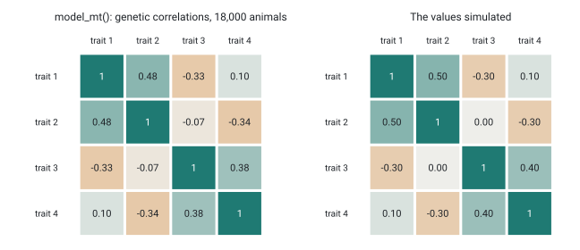
</picture>

*The genetic correlations of four traits estimated by `model_mt()`, beside the ones
simulated.*

<picture>
  <source media="(prefers-color-scheme: dark)" srcset="man/figures/README-pegs-dark.svg">
  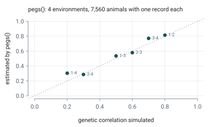
</picture>

*`pegs()` on one trait in four environments, with one record for each of 7,560 genotyped
animals: estimated against simulated genetic correlations.*
[More details](https://phyllype.github.io/BreedingR/articles/models.html#several-traits)

### Bayesian: `gibbs()`

`gibbs()` samples the same models in several chains, and `mcmc_diagnostics()` gives R-hat
and the effective sample sizes. `gibbs(family = "probit")` samples a binary trait on its
liability.

```r
gb <- gibbs(y ~ cg + animal(id), d, ped, n_iter = 20000, chains = 3)
mcmc_diagnostics(gb)
```

<picture>
  <source media="(prefers-color-scheme: dark)" srcset="man/figures/README-gibbs-dark.svg">
  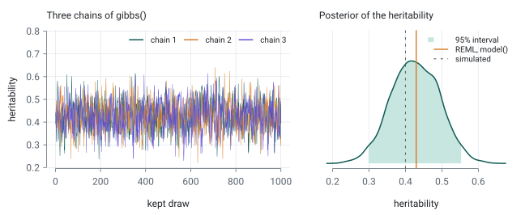
</picture>

*Three chains of `gibbs()` and the posterior of the heritability, beside the REML estimate
of `model()` and the value simulated.*
[More details](https://phyllype.github.io/BreedingR/articles/models.html#the-bayesian-half),
[the priors](https://phyllype.github.io/BreedingR/articles/choices.html#the-priors-of-gibbs)

### Genomics: single step, APY, ssSNPBLUP

Genotypes are an argument of the same fit. `genotypes =` turns A into H, `apy_core =`
approximates the inverse of G when the genotyped set is large, `snp_blup()`
solves the single step with the markers as equations and never forms G, and
`snp_effects()` backsolves the marker effects from a fit.

```r
fit <- model(y ~ cg + animal(id), d, ped, genotypes = list(ids = gids, m = M), apy_core = "auto")
snp_effects(fit, ped, genotypes = list(ids = gids, m = M))
```

<picture>
  <source media="(prefers-color-scheme: dark)" srcset="man/figures/README-genomics-dark.svg">
  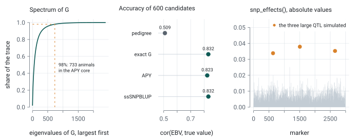
</picture>

*Left: the share of the trace of G explained by its largest eigenvalues; 98% sets the APY
core (Pocrnic et al., 2016). Middle: accuracy of genotyped candidates without records, by
route. Right: marker effects backsolved from the single-step fit, three large QTL
simulated.*

<picture>
  <source media="(prefers-color-scheme: dark)" srcset="man/figures/README-gamma-dark.svg">
  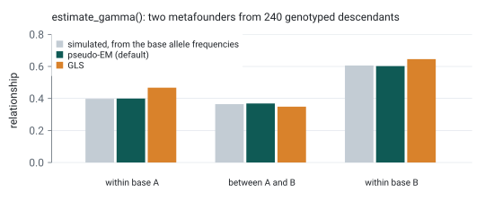
</picture>

*`estimate_gamma()` on 1,000 genotyped descendants of two simulated base populations. The
relationship within and between the metafounders, against the value from the base allele
frequencies.*
[More details](https://phyllype.github.io/BreedingR/articles/models.html#single-step-metafounders-and-markers),
[APY](APY.md)

### Selection decisions

`selection_index()` combines the breeding values of several traits with weights, and
`rank_drift()` tells how much a new evaluation reorders the candidates.

```r
idx <- selection_index(cbind(y1 = ebv1, y2 = ebv2), weights = c(y1 = 1, y2 = 1))
rank_drift(ebv(old_fit), ebv(new_fit), top = 100)
```

<picture>
  <source media="(prefers-color-scheme: dark)" srcset="man/figures/README-selection-dark.svg">
  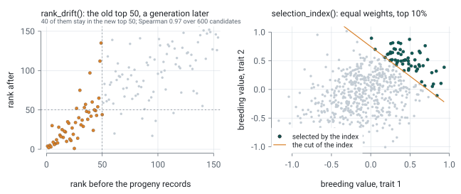
</picture>

*Left: the old top 100 of 4,000 candidates after the records of their progeny; 80 of them
stay in the new top 100. Right: the top 10% by an index of two traits with equal weights.*

### Diagnostics and data checks

Before a fit, `qc_phenotypes()` and `qc_genotypes()` flag problems and delete nothing, and
`parentage_check()` tests each parent against its offspring. Every
fitter reads the structure of the design and stops, or warns, with what to do. After the
fit, `residuals()` gives the conditional, standardized, marginal and Pearson residuals,
and `mcmc_diagnostics()` checks the chains.

```r
qc_phenotypes(d, "y", classes = "cg")
residuals(fit, type = "standardized")
mcmc_diagnostics(gb)
```

<picture>
  <source media="(prefers-color-scheme: dark)" srcset="man/figures/README-diagnostics-dark.svg">
  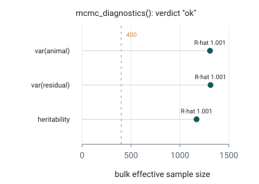
</picture>

<picture>
  <source media="(prefers-color-scheme: dark)" srcset="man/figures/README-message-dark.svg">
  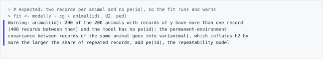
</picture>

*Above: `mcmc_diagnostics()` on the chains of `gibbs()`. Below: a structure check, as the
console shows it.*

<picture>
  <source media="(prefers-color-scheme: dark)" srcset="man/figures/README-qc-dark.svg">
  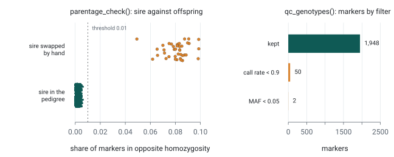
</picture>

*Left: `parentage_check()` with 40 sires swapped by hand; the 40 are the only pairs above
the threshold. Right: what each filter of `qc_genotypes()` removed from 2,000 markers.*
[More details](https://phyllype.github.io/BreedingR/articles/data-checks.html)

## In progress

- autoregressive models for the prediction of breeding values;
- indirect (social) genetic effects, including Bayesian ones;
- non-additive genetic effects;
- categorical traits and time to failure;
- growth curves fitted to repeated weighings;
- diagnostics of residuals and of the data structure.

## Under the hood

<picture>
  <source media="(prefers-color-scheme: dark)" srcset="man/figures/README-sparse-dark.svg">
  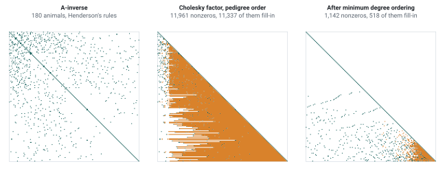
</picture>

*A-inverse of a simulated pedigree of 180 animals and its Cholesky factor, fill-in in
amber. In pedigree order the factor fills in to 11,961 nonzeros; after the minimum degree
ordering, 1,142.*

The mixed model equations are assembled sparse and factored by a sparse Cholesky after a
minimum degree ordering; the variance components come from AI-REML, and `converged`
takes both a small relative step and a Newton decrement under tolerance. The layout unit
is the covariance group, not the term, which is why direct-maternal and the reaction norm
have no fitter of their own.
[How the engine works](https://phyllype.github.io/BreedingR/articles/engine.html) and
[choices worth knowing about](https://phyllype.github.io/BreedingR/articles/choices.html).

## How this was validated

Nothing here is checked against itself: each piece answers to an independent path, such
as the dense V form, central finite differences, recovery of simulated components or the
published examples of Mrode and Pocrnic (2023), and the tests in `tests/testthat` run
these comparisons on every build.
[The table, piece by piece](https://phyllype.github.io/BreedingR/articles/validation.html).

## Documentation

- [*Your first evaluation*](https://phyllype.github.io/BreedingR/articles/getting-started.html):
  from two files on disk to breeding values you can act on. Start here.
- [*Theory and practice*](https://phyllype.github.io/BreedingR/articles/theory.html): a
  full evaluation in order, each matrix and algorithm beside the code that runs it.
- [*Hands-on*](https://phyllype.github.io/BreedingR/articles/hands-on.html): 39 of the 49
  exported functions, step by step.
- [FUNCTIONS.md](FUNCTIONS.md) maps the whole surface, and [REFERENCES.md](REFERENCES.md)
  lists the works the package implements. If a work that should be cited is missing,
  please open an issue or write to the maintainer address in DESCRIPTION.

## Questions and problems

Questions and suggestions are welcome at felipeoliveirafreitas@usp.br. If something
looks like a defect, opening an issue keeps the answer where the next person who hits
it will find it:

https://github.com/phyllype/BreedingR/issues

`CONTRIBUTING.md` says what makes a report easy to act on, and what a pull request is
checked against.

## License

GPL-3. Copyright (C) 2026 Felipe Andre Oliveira Freitas.

This program is free software: you can redistribute it and modify it under the terms of
the GNU General Public License, version 3, as published by the Free Software Foundation.
It is distributed in the hope that it will be useful, but WITHOUT ANY WARRANTY, without
even the implied warranty of MERCHANTABILITY or FITNESS FOR A PARTICULAR PURPOSE. The
full text is in `LICENSE.md` and at <https://www.gnu.org/licenses/>.

What that means day to day: use it, read it, change it and pass it on. What it asks in
return is that anything built on it and distributed carries the same licence and ships
its source. Running it for research and publishing the results is exactly what it is for,
and the citation below is the only thing asked there.

## Citation and funding

If this package contributed to published work, please cite it:

> Freitas, F. A. O. (2026). BreedingR: genetic parameters, breeding values and
> genomic prediction in R. R package version 0.4.0.

Developed during doctoral research at the Escola Superior de Agricultura Luiz de
Queiroz (ESALQ), Universidade de São Paulo, and at Purdue University, supported by

- the São Paulo Research Foundation (FAPESP), grants #2024/15502-6 and #2025/02949-5
  (BEPE);
- the Coordenação de Aperfeiçoamento de Pessoal de Nível Superior (CAPES), Finance
  Code 001;
- the Conselho Nacional de Desenvolvimento Científico e Tecnológico (CNPq).

The opinions, hypotheses and conclusions expressed here are the author's own and do not
necessarily reflect the views of the funding agencies.

Work that uses this package should carry the same acknowledgement, as the funding terms
ask.
